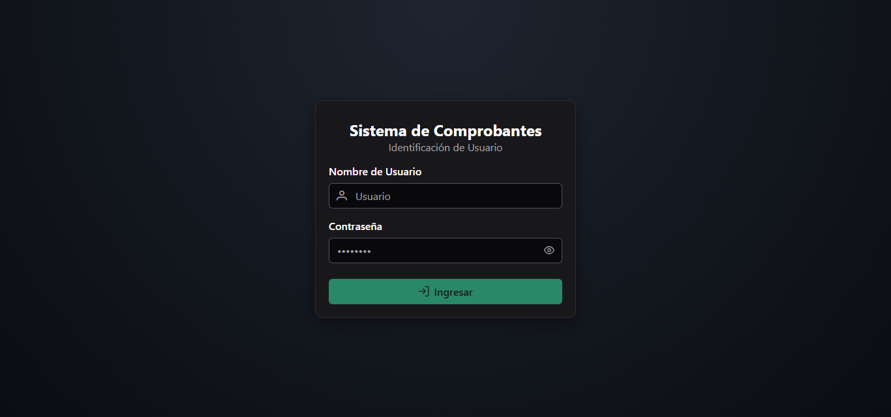
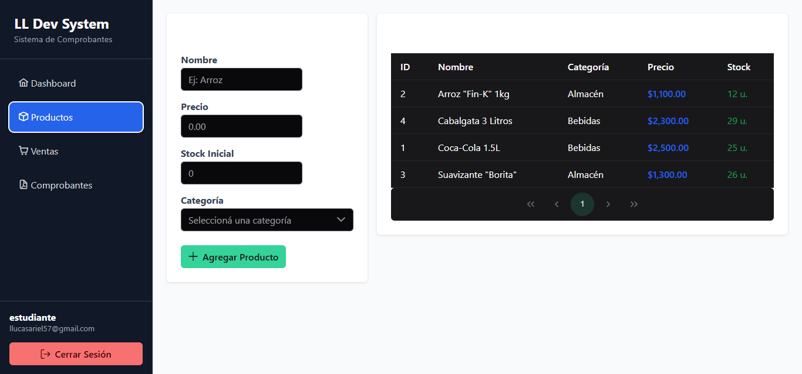
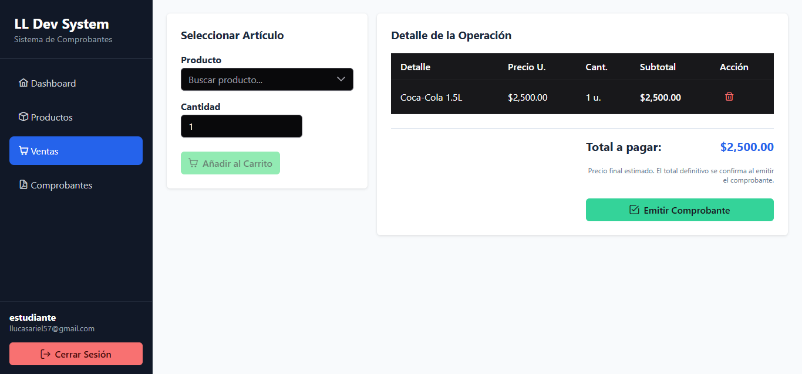
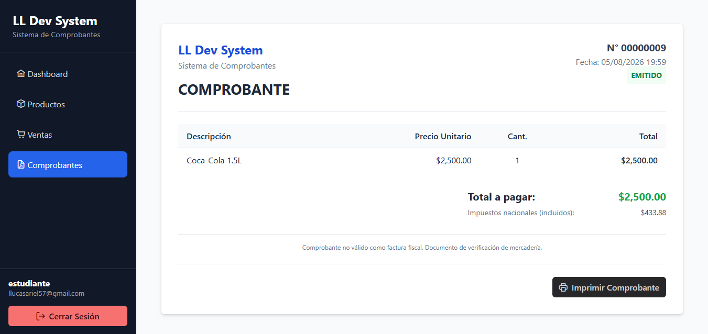

# Gestor de Stock y Comprobantes

Sistema web para la gestión de productos, stock, ventas y comprobantes de un comercio minorista de barrio. Permite registrar ventas, controlar el stock con un historial inmutable de movimientos, emitir comprobantes numerados e inalterables y consultar indicadores del negocio, con permisos diferenciados por rol.

Trabajo Final de la Tecnicatura Superior en Desarrollo de Software, Instituto Barranqueras (modalidad A, Proyecto de Aplicación).

## Stack tecnológico

- **Frontend:** Angular 21 (standalone, zoneless, Signals), PrimeNG 21 y Chart.js 4. Pruebas con Vitest.
- **Backend:** Django 5.2, Django REST Framework y SimpleJWT. Pruebas con el framework de Django.
- **Base de datos:** PostgreSQL.

## Funcionalidades

- Categorías, unidades de medida (con o sin decimales) y medios de pago administrables desde la aplicación.
- Productos con alta, modificación y activación/desactivación (sin borrado físico).
- Venta con carrito y cálculo reactivo de totales. El stock se descuenta al registrar la venta, de forma atómica y con bloqueo de filas para evitar inconsistencias por concurrencia.
- Anulación de ventas, que repone el stock.
- Comprobante opcional por venta, con numeración correlativa y contenido congelado e inalterable.
- Ingresos y ajustes de stock, con un historial de movimientos que no se puede modificar.
- Indicadores por período: ventas, ticket promedio, medios de pago y ranking de productos, con gráficos.
- Auditoría de operaciones protegida en la base de datos mediante disparadores (triggers).
- Autenticación JWT: el token de acceso vive solo en memoria y el de renovación en una cookie HttpOnly.

## Roles

| Rol | Alcance |
|---|---|
| Administrador | Usuarios, catálogos, productos, stock, ventas, indicadores y auditoría. |
| Cajero | Registra ventas, emite comprobantes y anula ventas. |
| Repositor | Registra ingresos y ajustes de stock. |

Los usuarios se gestionan desde el panel de administración de Django (`/admin`).

## Capturas de pantalla

### Login


### Productos


### Ventas


### Comprobante emitido


## Estructura del repositorio

```
gestor_stock_comprobantes/
├── frontend/   # Aplicación Angular
├── backend/    # API Django REST Framework (módulos en backend/apps)
├── database/   # Scripts SQL: definicion.sql y carga_inicial.sql
├── docs/       # Recursos de documentación
└── assets/     # Recursos gráficos
```

## Cómo correrlo localmente

Requisitos: Python 3.14, Node.js 22, npm y PostgreSQL.

### 1. Base de datos

Se crea un usuario (con permiso para crear bases, necesario para las pruebas) y una base a su nombre:

```bash
sudo -u postgres psql
CREATE USER gestor_user WITH PASSWORD 'cambiar_esta_clave' CREATEDB;
CREATE DATABASE gestor_stock OWNER gestor_user;
\q
```

### 2. Backend

```bash
cd backend
python3 -m venv venv
source venv/bin/activate
pip install -r requirements.txt
```

Crear el archivo `backend/.env` (no se versiona) con estas variables:

```
SECRET_KEY=una_clave_larga_y_aleatoria
DEBUG=True
DB_NAME=gestor_stock
DB_USER=gestor_user
DB_PASSWORD=cambiar_esta_clave
DB_HOST=localhost
DB_PORT=5432
```

Luego se crean las tablas con sus datos iniciales (roles, unidades de medida y medios de pago), el primer usuario Administrador y se inicia el servidor en http://localhost:8000:

```bash
python manage.py migrate
python manage.py createsuperuser
python manage.py runserver
```

Alternativa a `migrate`: cargar los scripts de la carpeta `database/` (definición y datos iniciales) con `psql`:

```bash
psql -h localhost -U gestor_user -d gestor_stock -f database/definicion.sql
psql -h localhost -U gestor_user -d gestor_stock -f database/carga_inicial.sql
```

Pruebas automáticas del backend:

```bash
python manage.py test
```

### 3. Frontend

```bash
cd frontend
npm install
ng serve
```

La aplicación queda disponible en http://localhost:4200. Pruebas automáticas: `ng test`.

## Documentación

Manual de Usuario, Manual de Instalación, Informe Técnico e Informe para la institución, entregados junto con el Trabajo Final.

## Autor

Lucas Ariel López. Tecnicatura Superior en Desarrollo de Software, Instituto Barranqueras (U.E.G.P. N.° 161), cohorte 2024.
