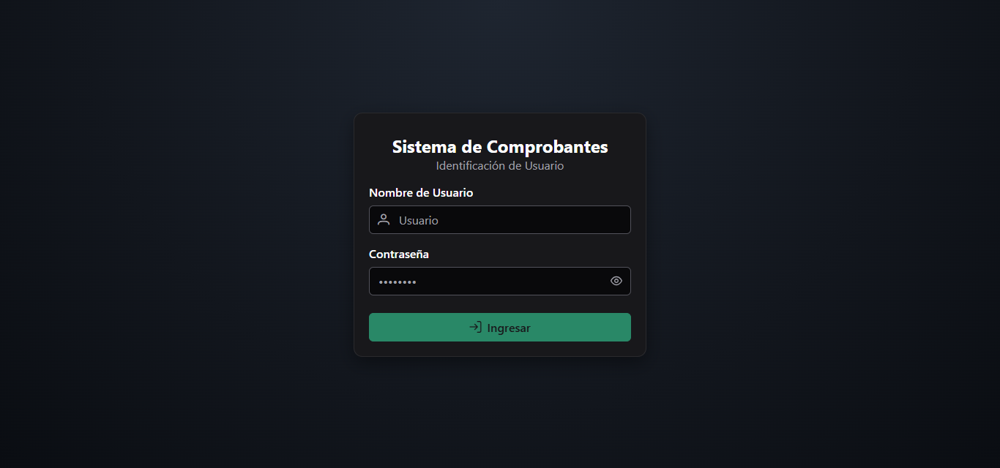
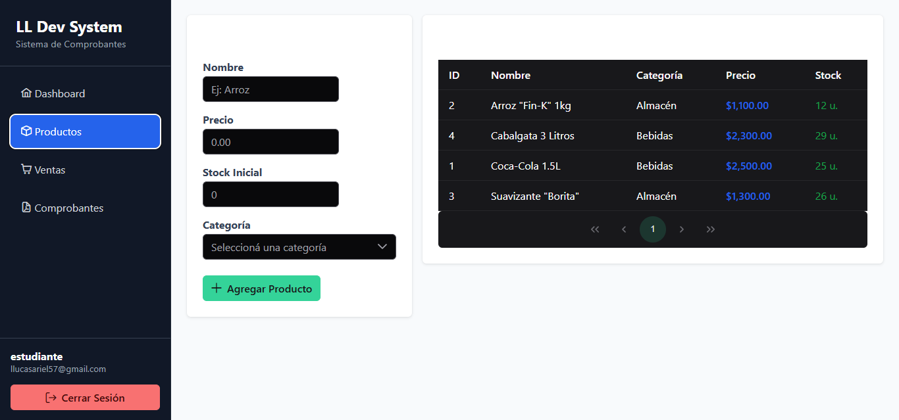
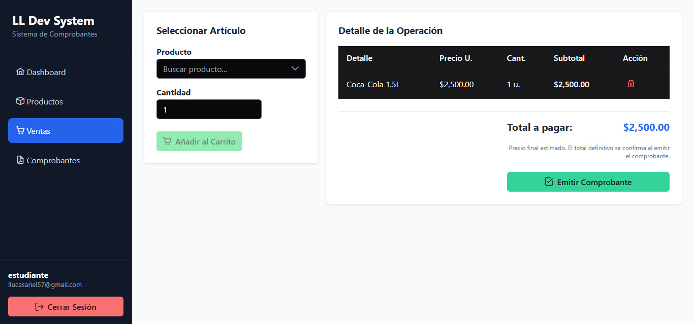
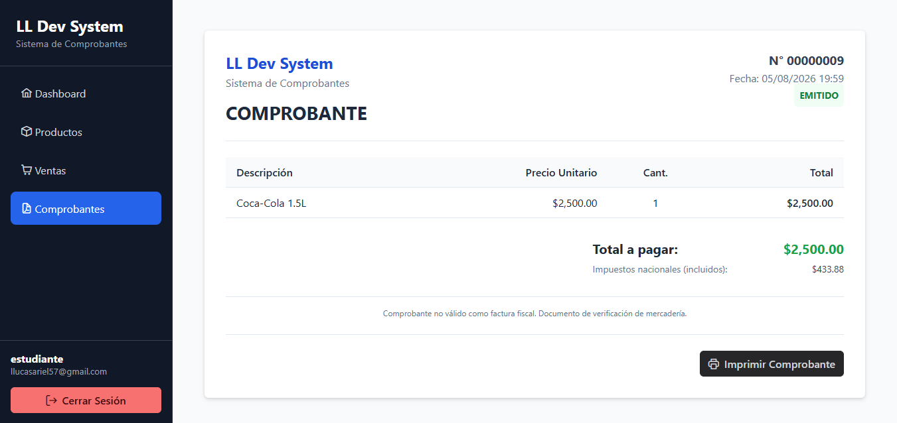

# Gestor de Stock y Comprobantes

Sistema de gestión de productos, ventas y emisión de comprobantes, pensado 
para un comercio de barrio que vende por reparto (pedidos vía WhatsApp).

## 🧱 Stack Tecnológico

**Frontend:** Angular 21 (standalone, zoneless) + PrimeNG + Signals
**Backend:** Django + Django REST Framework + PostgreSQL + JWT (SimpleJWT)

## ✨ Funcionalidades

- Gestión de categorías y productos (con soft-delete)
- Carrito de venta con cálculo reactivo de totales
- Emisión de comprobantes con congelamiento del estado de venta
- Descuento automático de stock al emitir comprobante
- Autenticación JWT con refresh automático

## 📸 Capturas de pantalla

### Login


### Productos


### Ventas


### Comprobante emitido


## 📂 Estructura del repositorio

```
gestor_stock_comprobantes/
├── frontend/     # Aplicación Angular
└── backend/      # API Django REST Framework
```

## 🚀 Cómo correrlo localmente

### Backend
```bash
cd backend
python -m venv venv
source venv/bin/activate  # o venv\Scripts\activate en Windows
pip install -r requirements.txt
python manage.py migrate
python manage.py runserver
```

### Frontend
```bash
cd frontend
npm install
ng serve
```

## 📚 Objetivos del proyecto

Este proyecto fue desarrollado para poner en práctica:

* Arquitectura Cliente–Servidor.
* Desarrollo de APIs REST.
* Integración entre Angular y Django.
* Autenticación JWT.
* Manejo de Access Token y Refresh Token.
* Consumo de servicios HTTP.
* Persistencia con PostgreSQL.
* Buenas prácticas de organización del código.
* Control de versiones con Git y GitHub.

## 📌 Contexto académico

Proyecto desarrollado para la materia Práctica Profesionalizante III.